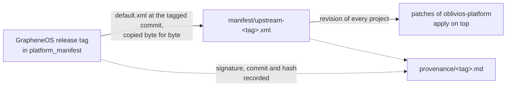

<p align="center">
  <a href="https://oblivios.org">
    <picture>
      <source media="(prefers-color-scheme: dark)" srcset="https://oblivios.org/brand/lockup-dark.svg">
      
    </picture>
  </a><br>
  <a href="https://oblivios.org">oblivios.org</a> · <a href="https://oblivios.dev">oblivios.dev</a>
</p>

<h1 align="center">oblivios-manifest</h1>

<p align="center">
  <strong>The pinned upstream baseline of ObliviOS.</strong><br>
  Which GrapheneOS and AOSP revisions the patches apply to, copied byte for byte and recorded with the checks that were made.
</p>

<p align="center">
  
  
  
</p>

> **Stage: source only.** No build, image or update service is offered and no device is supported
> ([ADR-171](https://github.com/Beau4201/oblivios-docs/blob/main/docs/governance/decision-log.md)). This repository holds no source
> trees: only a list of revisions and the records that justify them.

## What this is

An Android tree is assembled from over a thousand upstream projects, each at an exact revision. GrapheneOS publishes that list as the
`default.xml` of its `platform_manifest` repository, one version per release tag. ObliviOS keeps a copy of the list for each baseline it
has used or probed, so the patches in [`oblivios-platform`](https://github.com/Beau4201/oblivios-platform) always apply to a known,
checkable base.



## Contents

| Path | What it holds |
| --- | --- |
| `manifest/upstream-<tag>.xml` | `default.xml` of the GrapheneOS repository `platform_manifest` at the commit of the tag `<tag>`, byte for byte. It lists every upstream project with the revision to check out. |
| `provenance/<tag or build number>.md` | For each baseline or build: the tag, the commit it resolves to, the signature check of the tag, the hash of the manifest copy, and what was built and verified from it. The status of a baseline is stated at the top of its record. |
| [`overlays/README.md`](overlays/README.md) | An index of the patch packages in `oblivios-platform` and the upstream projects each one changes. It holds no patch content. |

Baselines recorded so far:

| Tag | Manifest copy | Record |
| --- | --- | --- |
| `2026071500` | [`manifest/upstream-2026071500.xml`](manifest/upstream-2026071500.xml) | [`provenance/2026071500.md`](provenance/2026071500.md) |
| `2026091900` | [`manifest/upstream-2026091900.xml`](manifest/upstream-2026091900.xml) | [`provenance/2026091900.md`](provenance/2026091900.md) |
| `2026100600` | [`manifest/upstream-2026100600.xml`](manifest/upstream-2026100600.xml) | [`provenance/2026100600.md`](provenance/2026100600.md) |
| `2026110200` | [`manifest/upstream-2026110200.xml`](manifest/upstream-2026110200.xml) | [`provenance/2026110200.md`](provenance/2026110200.md) |

`provenance/2026082417.md` records one earlier build by its build number rather than by a tag.

## Verify a baseline

The manifest is only a copy, so check it against upstream instead of trusting it:

```sh
git clone https://github.com/GrapheneOS/platform_manifest.git && cd platform_manifest

# The tag is signed; GrapheneOS publishes the allowed signers.
curl -fsSLO https://grapheneos.org/allowed_signers
git config gpg.ssh.allowedSignersFile "$PWD/allowed_signers"
git tag -v 2026100600

# The copy equals default.xml at the tagged commit.
git show 2026100600^{commit}:default.xml | cmp - /path/to/oblivios-manifest/manifest/upstream-2026100600.xml && echo identical
```

The SHA-256 of each copy, of the allowed-signers file and the signer's fingerprint are recorded in `provenance/<tag>.md`; compare
them with what you measure.

## Notes on the records

A record cited by path in a provenance record (the foundation repository, design and plan documents) may be in a private repository
and not published. The decisions are in the decision log of [`oblivios-docs`](https://github.com/Beau4201/oblivios-docs). The project
was named AegisOS, SovereignOS and FreeholdOS before ObliviOS (the rename is ADR-224); records written under those names keep them.

## Security

Do not open a public issue for a vulnerability. See [`SECURITY.md`](SECURITY.md) for the contact, the PGP key and what to expect.

## Licence

Apache-2.0 for the overlays index and the provenance records, see [`LICENSE`](LICENSE) and [`NOTICE`](NOTICE). The manifest copies keep
the licence of their upstream; `NOTICE` says which.

The name ObliviOS and its logo are not licensed. ObliviOS is based on GrapheneOS; it is not affiliated with or endorsed by the
GrapheneOS project.
